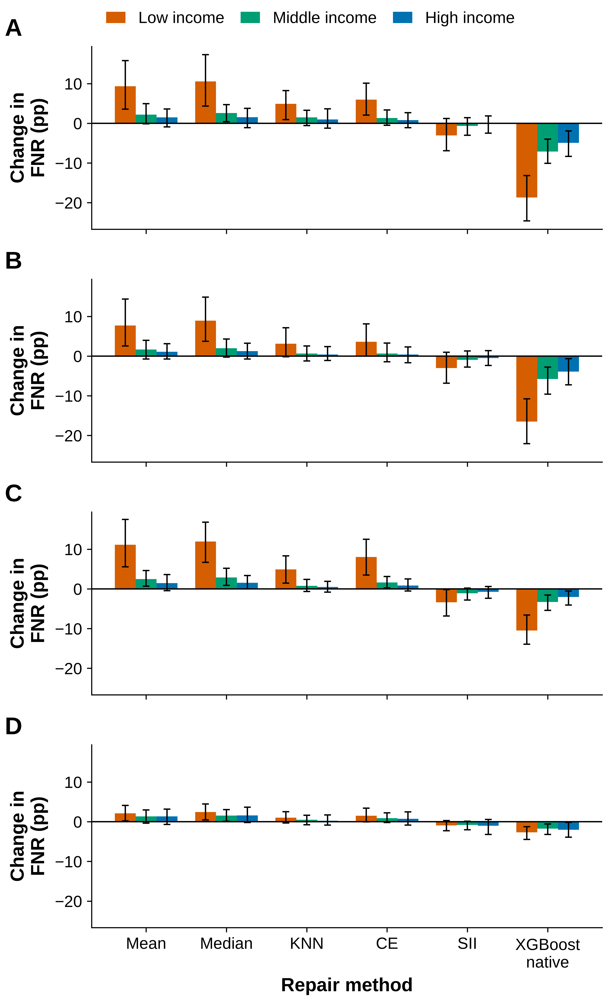
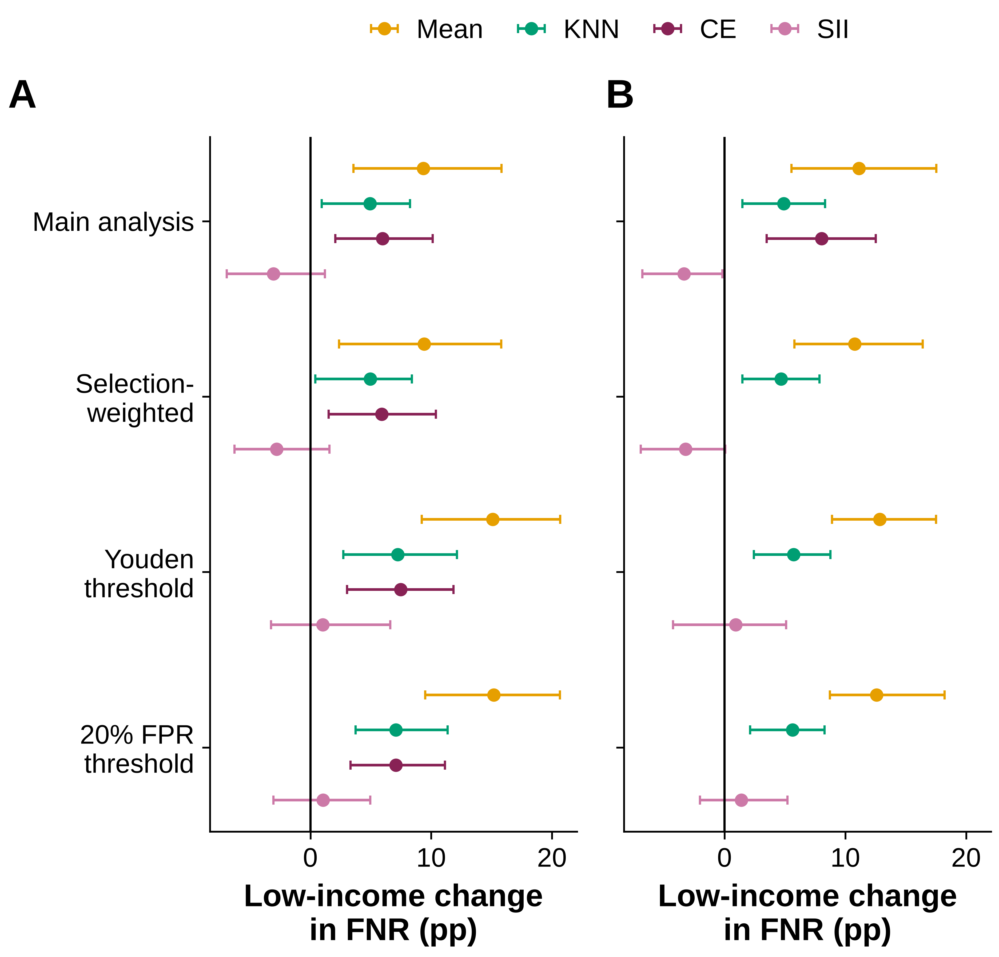

# CKD Missingness: a simulation stress test of income-dependent missing data in CKD screening

**Author:** Pranav Mamidala · **Mentor:** Samira Vedantam · **License:** MIT

This repository has the code, aggregate results, figures, and manuscript for *"A simulation study of income-dependent missing data and kidney disease screening errors across income groups"*. The study is a **simulated stress test**. Starting from complete records of adults in NHANES 2013–2018 (N = 12,546), it deletes model inputs on purpose, with deletion rates that depend on income (30% / 10% / 5% for low / middle / high income in the confirmatory design). An XGBoost chronic kidney disease (CKD) classifier is then trained on the repaired data. CKD is defined from CKD-EPI 2021 eGFR < 60 or UACR ≥ 30 mg/g, and creatinine, UACR, eGFR and BUN are never inputs. Every imputer is fit on training data only. The outcome is the change in false-negative rate (ΔFNR) by income group, plus the low-income minus high-income FNR disparity.

## Key results (confirmatory scenario S0, ΔFNR in percentage points, 95% CI)

| Repair | Low income | High income | Low − high |
|---|---|---|---|
| Chained-equation imputation (CE; preregistered "MICE") | **+6.0 (2.1, 10.1)** | +0.8 (−1.1, 2.7) | +5.1 (1.0, 9.7) |
| KNN (k = 5) | **+4.9 (0.9, 8.3)** | +1.0 (−1.2, 3.7) | +4.0 (−0.7, 8.0) |

- **Uniform-deletion control (S11, 15% for everyone):** no clear income gap. Low − high was −0.6 (−5.0, 4.0) for CE and −0.5 (−4.8, 4.4) for KNN.
- **Empirically calibrated NHANES nonmeasurement patterns (S3, exploratory):** no clear increase. Every low − high interval includes zero, for example CE +0.8 (−1.0, 2.7) and KNN +0.8 (−1.1, 2.4).

> In the scenarios examined, a substantial increase in the false-negative disparity was observed under the larger assumed missingness gradient, whereas no clear increase was detected under empirically calibrated NHANES patterns.

Full numbers: [`results/table2_primary.csv`](results/table2_primary.csv) and [`results/table3_sensitivity.csv`](results/table3_sensitivity.csv).




## Repository layout
```
scripts/            analysis pipeline (00–15) + shared modules (config.py, common.py, v4lib.py)
results/            aggregate results only (CSV/JSON/logs); results/appendix/ holds supplementary CSV tables
figures/            Figures 1–5 (PNG, PDF, TIFF)
paper/              manuscript (PDF + DOCX)
manuscript_build/   scripts that build the manuscript and check JEI length limits
data/               empty; filled by 00_download_nhanes.py (git-ignored)
run_all.sh          runs the full pipeline in order
```

## Reproduce
```bash
python3 -m venv .venv && source .venv/bin/activate   # Python 3.13 was used
pip install -r requirements.txt
bash run_all.sh
```
NHANES data are public and are **not** redistributed here. `scripts/00_download_nhanes.py` downloads the needed XPT files (DEMO, BMX, BPX/BPXO, GHB, BPQ, SMQ, BIOPRO, ALB_CR, TCHOL for cycles H, I, J and L) from the CDC into `data/raw/`.

Run order (`run_all.sh`):
1. `00_download_nhanes.py` → `01_harmonize_nhanes.py` → `02_descriptives.py`
2. Exploratory analyses: `03_repeated_splits.py` (RUN=main, RUN=ablation) → `04_external.py` → `05_aggregate.py` → `07_decision_curve.py` → `08_tables.py` → `09_realized_rates.py`
3. Confirmatory inference: `10_selection_weights.py` → `11_v4_core.py` (RUN=point / boot / inner, then SCEN=S11) → `12_coverage_sim.py` → `13_v4_aggregate.py` (and `_h2`) → `14_v4_tables.py` → `15_v4_figures.py`

All randomness is seeded (`SEED = 20261005`). The bootstrap takes roughly 1.5 h on 8 cores. Per-replicate `.pkl` intermediates are regenerated by the pipeline and are not committed.

## Confidence intervals
CIs come from a stratum-preserving PSU bootstrap that respects the NHANES design. In each of **120 replicates**, the 2 PSUs in each stratum are resampled with replacement. The whole pipeline (splits, model, imputers, thresholds) is then refit with 4-fold stratum cross-fitting × 2 masks. Intervals are percentile intervals rescaled by √2 (the √(n_h/(n_h−1)) correction with n_h = 2). In a coverage simulation (`12_coverage_sim.py`) this approach was conservative.

## Limitations
- This is a simulation. Deletion is imposed on complete records, so the assumed income gradients are hypotheses, not measured EHR missingness.
- S3 reflects survey nonparticipation and nonmeasurement in NHANES, not clinical test-ordering patterns.
- CKD is defined from a single visit, and the cohort is complete-case. Selection weighting (`10_selection_weights.py`) changed no estimate by more than 0.3 pp but cannot rule out other selection effects.
- Only S0 is confirmatory. All other scenarios, mechanism analyses and decision curves are exploratory.
- The primary model is XGBoost; other models and thresholds were checked only in exploratory analyses.

## Citation
```
Mamidala P. A simulation study of income-dependent missing data and kidney disease screening errors across income groups. 2026.
Code: https://github.com/prnvmamidala-cmd/ckd-missingness
```

## License
MIT. See [LICENSE](LICENSE).
